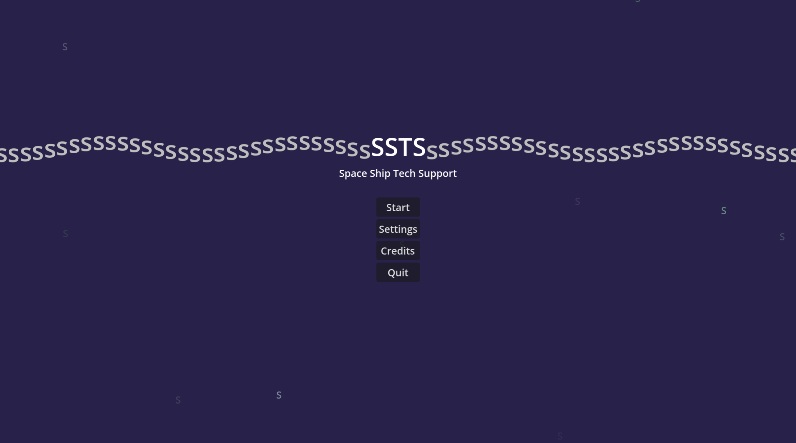
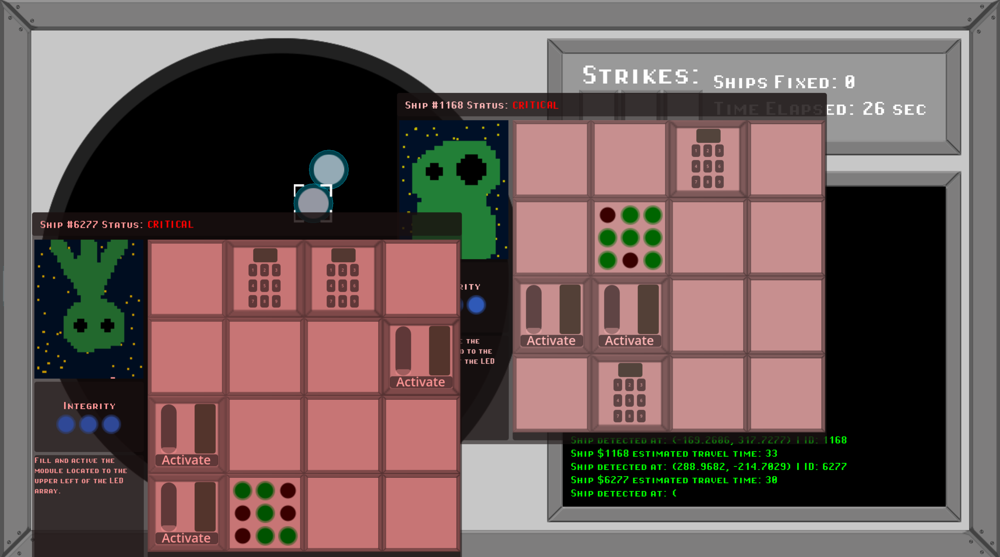

# SSTS
### Space ship tech support - for Godot Wildjam 98

This is the repository for the game SSTS (Space ship tech support) made by a team of three for the godot wildjam 98. The theme of the jam was "Signal".  
The core gameplay is to diagnose and then fix space ships that are within reach and you have to fix them before you lose signal to them.

The goal of the jam for us was to primarily learn more stuff - mainly UI - and we didn't have much time to actually work on the game. Most of the game was made within the last 2-3 days.

